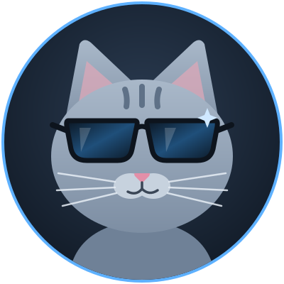

---
hide:
  - navigation
  - toc
---

{ .hero-cat }

# Hey, I'm Bryce

Just a simple IT Guy who builds things for fun.

[:fontawesome-brands-github: GitHub](https://github.com/bryceforsm){ .md-button }
[:material-email-outline: Email me](mailto:bryceforsm@gmail.com){ .md-button }

## About

By day I keep pipelines green and servers happy. By night (and most weekends) I keep doing the
same thing at home, just with fewer meetings. Everything you find in my repos is a hobby project.
Some of it is polished, some of it is held together with duct tape and good intentions.

-   :material-server-network:{ .lg } **Homelab**

    Racks, VMs and containers that exist mostly because I wanted to see if I could.

-   :material-robot-outline:{ .lg } **Automation**

    Scripts and pipelines for anything I have to do more than twice.

-   :material-coffee-outline:{ .lg } **Tinkering**

    Breaking things on purpose so I know how to fix them later.

